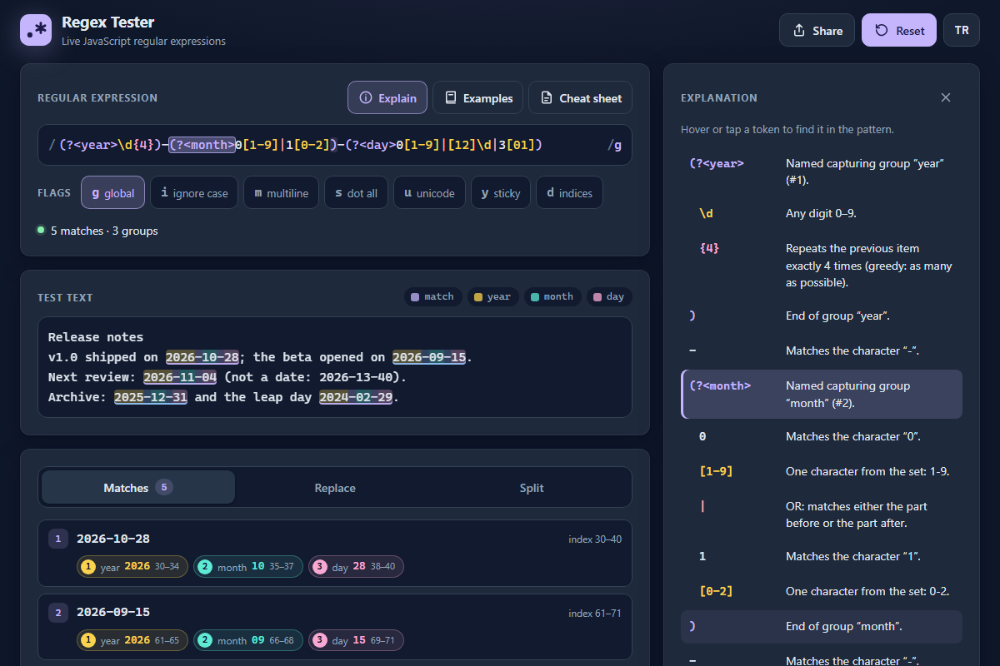

# Regex Tester - live JavaScript regular expressions with inline highlights and plain-language explanations

[](#tests)
[](LICENSE)

**▶ Open the app: https://celaldrg.github.io/regex-tester/**



A regular expression tester that runs entirely in your browser. Type a pattern and see every match and capture group highlighted in your text, preview `replace` and `split`, and read what each part of the pattern does, in English or Turkish.

## Features

- **Live matching** with the browser's own JavaScript engine: every match is highlighted inline, and each capture group gets its own colour (see the colour key above the text).
- **Flag toggles** for `g`, `i`, `m`, `s`, `u`, `y` and `d`.
- **Match list**: each match with its position and its groups (number, name, value and position). Hover or tap a match to find it in the text.
- **Replace tab** with a live preview. `$1`, `$<name>`, `$&`, `` $` ``, `$'` and `$$` behave exactly like `String.prototype.replace`; chips insert the group references and the result can be copied.
- **Split tab**: the parts `String.prototype.split` returns, with separators captured by groups marked.
- **Explanation panel**: every token in plain language. Hover or tap a row to highlight that token in the pattern, together with its partner (the other bracket, the item a quantifier repeats or the group a back-reference points to).
- **Cheat sheet drawer**: characters, anchors, quantifiers, groups, lookarounds, flags and replacement syntax. Tap an entry to insert it; flag entries switch the flag.
- **Example library**: email-like address, web address, Turkish mobile number, Turkish IBAN format, ISO date, hex colour and capitalized words in any alphabet, each with lines that should and should not match.
- **Share links**: pattern, flags, text, replacement and tab are kept in the URL hash, so the address is always ready to share.
- **Backtracking guard**: patterns you type run in a Web Worker that is stopped after 500 ms, with a notice that explains why (try `(a+)+$` on a long row of `a`s ending in `b`).
- **English and Turkish** interface; the choice is remembered.
- No build step, no dependencies and no requests to other sites.

## How to use

Type a pattern in the top field (without the surrounding slashes), switch flags with the buttons under it and edit the test text below. Results update as you type.

**Keyboard**

| Key | Action |
| --- | --- |
| `/` | Jump to the pattern field |
| `?` | Open the cheat sheet |
| `Tab` / `Shift+Tab` | Move between controls; `Enter` or `Space` presses a button |
| `←` `→` `Home` `End` | Switch between the Matches, Replace and Split tabs |
| `↑` `↓` `Home` `End` | Move through matches, explanation rows, cheat sheet entries and examples |
| `Enter` on a match or a row | Pin its highlight (press again to unpin) |
| `Esc` | Close the cheat sheet or the example library |

**Touch**

- Tap a flag to switch it on or off.
- Tap a match card to highlight that match in the text; tap an explanation row to highlight its token in the pattern. Tap again to clear.
- **Examples** and **Cheat sheet** open as sheets from the bottom; tap outside them or the close button to dismiss.
- **Share** opens your phone's share sheet (on other devices it copies the link).

## Run locally

The app is plain HTML, CSS and ES modules. Serve the folder with any static server, for example:

```sh
npx serve .
```

Then open the address it prints. ES modules and the worker need `http://`; opening `index.html` as a `file://` URL does not work.

## Tests

```sh
node --test
```

Node 22 or newer, no install step. The suites cover:

- matching, group indices, named groups and the result cap (`regex.js`);
- replacement templates and `split`, compared with the built-in `String.prototype` methods;
- the tokenizer and the explanations in both languages;
- the worker guard (newest request wins, 500 ms timeout, crash and restart) with a fake worker and fake timers;
- app state, share links, the `?demo` state and the example library;
- string tables (same keys and placeholders in both languages, every key the page uses exists), the storage helper with blocked storage, the view helpers, and the page itself (meta tags, element ids, no remote requests).

## Project structure

```text
index.html          page and meta tags
style.css           dark theme, mobile-first layout
src/
  regex.js          matching, replace, split, highlight segments
  tokenizer.js      splits a pattern into tokens
  explain.js        token and error descriptions (EN + TR)
  cheatsheet.js     cheat sheet entries and flag descriptions
  library.js        example library
  state.js          app state, share hash, ?demo state
  runner.js         worker guard with the time limit
  view.js           status, colours and token partners for the UI
  i18n.js           interface strings (EN + TR)
  storage.js        localStorage helper that never throws
  worker.js         module worker that runs the analysis
  main.js           events, rendering, share and language
  render.js         editor mirrors, lists and the explanation
  panels.js         cheat sheet and example library dialogs
  dom.js            small DOM helpers
test/               node:test suites
docs/screenshot.png
```

Everything except `worker.js` and the four UI modules (`main.js`, `render.js`, `panels.js`, `dom.js`) is pure and runs under Node.

## License

[MIT](LICENSE) © 2026 Celalettin Durgaç

## Türkçe

Tamamen tarayıcıda çalışan bir düzenli ifade (regex) deneme aracı. Bir desen yazın; her eşleşme ve yakalama grubu metnin içinde işaretlenir, `replace` ve `split` sonuçları anında görünür, desenin her parçası Türkçe ya da İngilizce açıklanır.

**▶ Uygulamayı aç: https://celaldrg.github.io/regex-tester/**

### Özellikler

- Tarayıcının kendi JavaScript motoruyla **canlı eşleştirme**: her eşleşme metinde işaretlenir, her yakalama grubu kendi rengini alır.
- `g`, `i`, `m`, `s`, `u`, `y` ve `d` **bayrak düğmeleri**.
- **Eşleşme listesi**: her eşleşmenin konumu ve grupları (numara, ad, değer, konum). Bir eşleşmenin üzerine gelince ya da dokununca metinde gösterilir.
- **Değiştir sekmesi**: `$1`, `$<ad>`, `$&`, `` $` ``, `$'` ve `$$` tam olarak `String.prototype.replace` gibi çalışır; grup başvurularını ekleyen düğmeler ve kopyalama düğmesi vardır.
- **Böl sekmesi**: `String.prototype.split` sonucundaki parçalar; gruplarla yakalanan ayraçlar işaretlenir.
- **Açıklama paneli**: her parça sade bir dille anlatılır. Bir satırın üzerine gelince ya da dokununca o parça desende, eşiyle birlikte (öbür parantez, niceleyicinin tekrarladığı öğe, geri başvurunun gösterdiği grup) vurgulanır.
- **Hızlı başvuru çekmecesi**: karakterler, çapalar, niceleyiciler, gruplar, çevre bakışları, bayraklar ve değiştirme sözdizimi. Bir öğeye dokunmak onu desene ekler; bayrak öğeleri bayrağı açıp kapatır.
- **Örnek kütüphanesi**: e-posta benzeri adres, web adresi, Türkiye cep telefonu, TR IBAN biçimi, tarih, onaltılık renk kodu ve her alfabede büyük harfle başlayan kelime; her birinde eşleşmesi gereken ve gerekmeyen satırlar.
- **Paylaşım bağlantısı**: desen, bayraklar, metin, değiştirme metni ve sekme adresin `#` kısmında tutulur.
- **Geri izleme koruması**: yazdığınız desenler bir Web Worker içinde çalışır ve 500 ms'de durdurulur; nedenini anlatan bir uyarı çıkar.
- **Türkçe ve İngilizce** arayüz; seçim hatırlanır.
- Derleme adımı, bağımlılık ve başka sitelere istek yok.

### Nasıl kullanılır

Üstteki alana deseni (eğik çizgiler olmadan) yazın, altındaki düğmelerle bayrakları seçin ve test metnini düzenleyin. Sonuçlar siz yazdıkça güncellenir.

- **Klavye**: `/` desen alanına geçer, `?` hızlı başvuruyu açar. `←` `→` sekmeler arasında, `↑` `↓` eşleşmeler, açıklama satırları, başvuru öğeleri ve örnekler arasında gezinir; `Enter` vurguyu sabitler, `Esc` açık pencereyi kapatır.
- **Dokunmatik**: bayrağa dokunmak onu açar ya da kapatır; bir eşleşme kartına ya da açıklama satırına dokunmak onu vurgular, yeniden dokunmak kaldırır. **Örnekler** ve **Hızlı başvuru** alttan açılır; dışına ya da kapatma düğmesine dokunarak kapanır. **Paylaş** telefonda paylaşım menüsünü açar.

### Yerelde çalıştırma

Klasörü herhangi bir statik sunucuyla açın, örneğin `npx serve .`. ES modülleri ve worker `http://` ister; `index.html` dosyasını `file://` ile açmak çalışmaz.

### Testler

`node --test` (Node 22 ya da üstü, kurulum gerekmez). Eşleştirme, gruplar, değiştirme ve bölme (yerleşik `String.prototype` yöntemleriyle karşılaştırmalı), belirteçler ve iki dilde açıklamalar, worker koruması (zaman aşımı, çökme, yeniden başlatma), uygulama durumu ve paylaşım bağlantısı, dil tabloları, depolama yardımcısı ve sayfanın kendisi test edilir.

### Proje yapısı

```text
index.html          sayfa ve meta etiketleri
style.css           koyu tema, önce mobil yerleşim
src/
  regex.js          eşleştirme, değiştirme, bölme, vurgu parçaları
  tokenizer.js      deseni belirteçlere ayırır
  explain.js        belirteç ve hata açıklamaları (EN + TR)
  cheatsheet.js     hızlı başvuru öğeleri ve bayrak açıklamaları
  library.js        örnek kütüphanesi
  state.js          uygulama durumu, paylaşım bağlantısı, ?demo durumu
  runner.js         süre sınırlı worker koruması
  view.js           arayüz için durum, renkler ve belirteç eşleri
  i18n.js           arayüz metinleri (EN + TR)
  storage.js        hiç hata vermeyen localStorage yardımcısı
  worker.js         analizi çalıştıran modül worker
  main.js           olaylar, çizim, paylaşım ve dil
  render.js         düzenleyici aynaları, listeler ve açıklama
  panels.js         hızlı başvuru ve örnek kütüphanesi pencereleri
  dom.js            küçük DOM yardımcıları
test/               node:test test takımları
docs/screenshot.png
```

`worker.js` ve dört arayüz modülü (`main.js`, `render.js`, `panels.js`, `dom.js`) dışındaki her şey DOM kullanmaz ve Node altında çalışır.

### Lisans

[MIT](LICENSE) © 2026 Celalettin Durgaç
